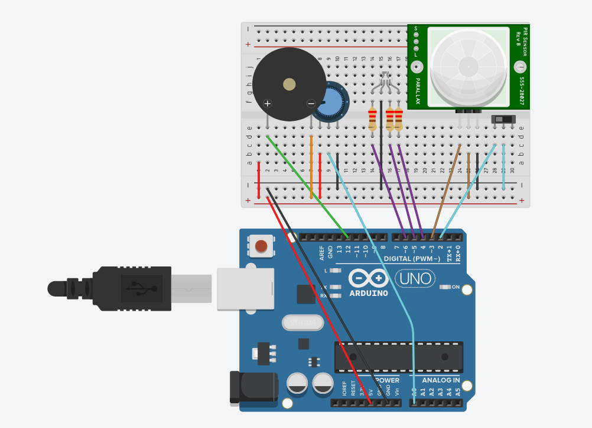

# Burglar Alarm

A simple Arduino burglar alarm that uses a PIR motion sensor, RGB led and a Piezo buzzer. The slide switch arms and disarms the alarm.
This project is for an embedded systems course. 

## How it works

- Switch OFF (disarmed), RGB = Blue, Piezo = Silent
- Switch ON, no motion detected, RGB = Green, Piezo = Silent
- Switch ON, motion detected, RGB = Red, Piezo = Alarm sound (500 Hz)

## Components

- Arduino Uno
- PIR motion sensor
- RGB led
- Piezo buzzer
- Slide switch
- Resistors for the LED (220 Ω)
- Wires and a breadboard

## Pin connections

## Usage

1. Wire the components according to the picture above.
2. Open the sketch in the Arduino IDE and upload it to your board.
3. Slide the switch to the ON position to arm the alarm. The LED turns green.
4. If the PIR sensor detects movement, the LED turns red and the piezo sounds.
5. Slide the switch to OFF to disarm the alarm. The LED turns blue.
